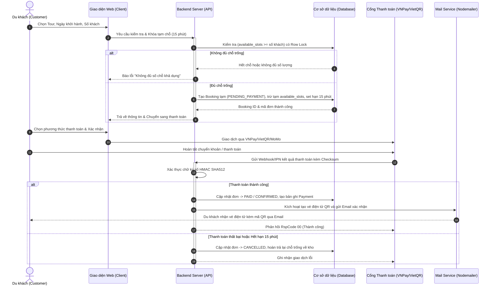
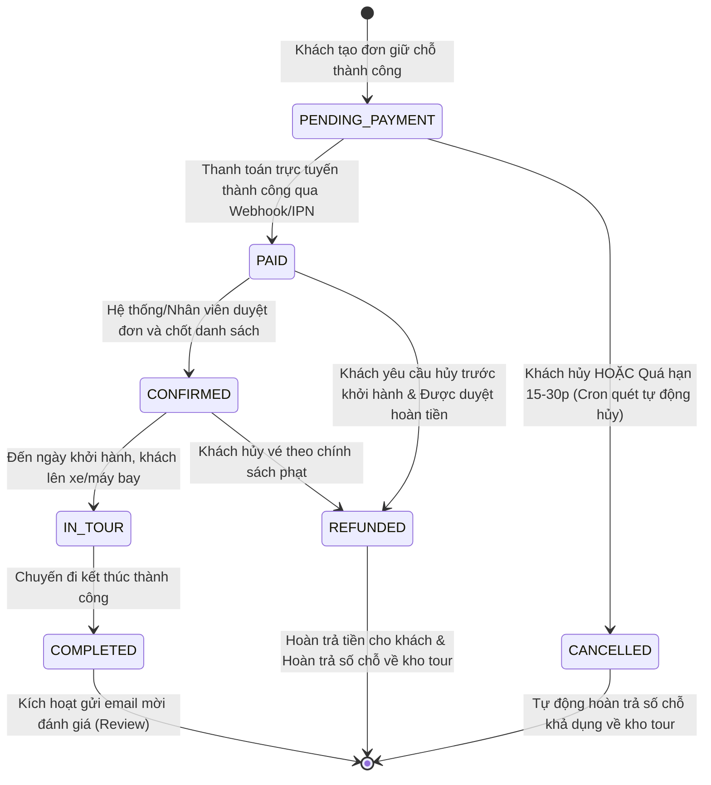

# BÁO CÁO DỰ ÁN PHÁT TRIỂN PHẦN MỀM
# HỆ THỐNG ĐẶT TOUR DU LỊCH TRỰC TUYẾN - TRAVEL WITH ME

---

## MỤC LỤC
1. [CHƯƠNG 1: TỔNG QUAN ĐỀ TÀI & KHẢO SÁT HIỆN TRẠNG](#chương-1-tổng-quan-đề-tài--khảo-sát-hiện-trạng)
2. [CHƯƠNG 2: ĐẶC TẢ YÊU CẦU HỆ THỐNG (SRS)](#chương-2-đặc-tả-yêu-cầu-hệ-thống-srs)
3. [CHƯƠNG 3: QUY TRÌNH NGHIỆP VỤ & SƠ ĐỒ THIẾT KẾ CỐT LÕI](#chương-3-quy-trình-nghiệp-vụ--sơ-đồ-thiết-kế-cốt-lõi)
4. [CHƯƠNG 4: THIẾT KẾ CƠ SỞ DỮ LIỆU & KIẾN TRÚC HỆ THỐNG](#chương-4-thiết-kế-cơ-sở-dữ-liệu--kiến-trúc-hệ-thống)
5. [CHƯƠNG 5: HIỆN THỰC HÓA GIAO DIỆN & KẾT QUẢ ĐẠT ĐƯỢC](#chương-5-hiện-thực-hóa-giao-diện--kết-quả-đạt-được)
6. [CHƯƠNG 6: HƯỚNG DẪN CÀI ĐẶT & VẬN HÀNH HỆ THỐNG](#chương-6-hướng-dẫn-cài-đặt--vận-hành-hệ-thống)
7. [CHƯƠNG 7: ĐÁNH GIÁ & HƯỚNG PHÁT TRIỂN TƯƠNG LAI](#chương-7-đánh-giá--hướng-phát-triển-tương-lai)

---

# CHƯƠNG 1: TỔNG QUAN ĐỀ TÀI & KHẢO SÁT HIỆN TRẠNG

### 1.1. Bối cảnh đề tài
Trong thời đại chuyển đổi số mạnh mẽ, ngành du lịch Việt Nam đang chứng kiến sự thay đổi sâu sắc trong hành vi tiêu dùng. Thay vì phải đến trực tiếp các đại lý du lịch truyền thống để nhận tư vấn, xếp hàng đăng ký hoặc trao đổi thủ công qua giấy tờ, du khách ngày nay ưu tiên việc tìm kiếm, so sánh lịch trình và thanh toán đặt chỗ trực tuyến (OTA - Online Travel Agency) ngay trên máy tính hoặc điện thoại thông minh.

Dự án **Travel With Me** ra đời nhằm giải quyết triệt để bài toán kết nối giữa du khách và các công ty lữ hành, xây dựng một nền tảng thương mại dịch vụ du lịch hoàn chỉnh, chuyên nghiệp và an toàn.

### 1.2. Mục tiêu của dự án
- **Đối với Du khách (Khách hàng cá nhân & Gia đình):**
  - Tiết kiệm thời gian, dễ dàng so sánh các tour du lịch theo địa điểm, thời gian, phương tiện và mức giá.
  - Cung cấp thông tin trực quan, minh bạch: lịch trình từng ngày (Itinerary), hình ảnh thực tế, bảng giá theo độ tuổi, dịch vụ bao gồm/chưa bao gồm và chính sách hoàn hủy.
  - Quy trình đặt chỗ mượt mà, hỗ trợ thanh toán đa kênh (VNPay, MoMo, VietQR, Thẻ quốc tế, Tiền mặt) và nhận ngay vé điện tử (E-Ticket) có mã QR Code.
  - Tăng cường trải nghiệm thông qua đánh giá thực tế và trợ lý du lịch AI tư vấn 24/7.
- **Đối với Doanh nghiệp & Quản trị viên lữ hành:**
  - Quản lý tập trung sản phẩm tour, lịch khởi hành và số chỗ trống (Inventory Slots) theo thời gian thực.
  - Loại bỏ hoàn toàn tình trạng đặt vượt quá số chỗ (Overbooking).
  - Tự động hóa quy trình quản lý đơn hàng, điều phối hướng dẫn viên, xuất danh sách khách (Excel/CSV) và xử lý hoàn tiền minh bạch.
  - Báo cáo thống kê trực quan doanh thu, tỷ lệ lấp đầy tour và tỷ lệ hủy để tối ưu hóa chiến lược kinh doanh.

### 1.3. Các tác nhân tham gia hệ thống (Actors)
1. **GUEST (Khách vãng lai):** Người dùng chưa đăng nhập, được xem danh mục tour, tìm kiếm, lọc, đọc cẩm nang và hỏi đáp bot.
2. **CUSTOMER (Du khách / Thành viên):** Người dùng có tài khoản, thực hiện đặt tour, giữ chỗ, áp mã giảm giá, thanh toán, quản lý vé QR, hủy tour theo chính sách và gửi đánh giá.
3. **STAFF (Nhân viên điều hành):** Tiếp nhận danh sách booking, kiểm tra tình trạng thanh toán, cập nhật trạng thái đơn và xuất danh sách hành khách cho hướng dẫn viên.
4. **ADMIN (Quản trị viên cấp cao):** Toàn quyền kiểm soát hệ thống: CRUD tour, cấu hình suất đặt, phân quyền tài khoản, tạo mã voucher và theo dõi biểu đồ doanh thu.
5. **SYSTEM (Hệ thống tự động):** Tiến trình Cron tự động quét đơn quá hạn hủy chỗ, gửi email nhắc lịch trước ngày đi và kích hoạt mời đánh giá sau tour.

---

# CHƯƠNG 2: ĐẶC TẢ YÊU CẦU HỆ THỐNG (SRS)

### 2.1. Ma trận yêu cầu chức năng Phân hệ Khách hàng (Client Portal)
| Mã UC | Nhóm chức năng | Tên chức năng | Tác nhân | Mô tả luồng xử lý | Quy tắc nghiệp vụ |
| :--- | :--- | :--- | :--- | :--- | :--- |
| **CLI-AUTH-01** | Xác thực | Đăng ký & Kích hoạt | GUEST | Nhập họ tên, email, mật khẩu; hệ thống gửi email xác thực OTP/link. | Mật khẩu >= 8 ký tự, có chữ hoa, số; link kích hoạt hết hạn sau 15 phút. |
| **CLI-AUTH-02** | Xác thực | Đăng nhập hệ thống | GUEST | Đăng nhập bằng Email/Password hoặc Google OAuth 2.0. | Sai mật khẩu 5 lần khóa tạm 15 phút; cấp JWT Access & Refresh Token trong HTTP-only Cookie. |
| **CLI-AUTH-03** | Xác thực | Quên / Đổi mật khẩu | GUEST, USER | Yêu cầu reset link qua email; hoặc đổi mật khẩu trong trang cá nhân. | Token reset mật khẩu có thời hạn 10 phút, chỉ sử dụng một lần. |
| **CLI-PROF-01** | Hồ sơ | Cập nhật thông tin cá nhân | CUSTOMER | Xem và chỉnh sửa họ tên, SĐT, ngày sinh, địa chỉ, tải ảnh đại diện lên Cloudinary. | File ảnh JPG/PNG/WEBP < 5MB; SĐT kiểm tra 10 chữ số chuẩn Việt Nam. |
| **CLI-PROF-02** | Hồ sơ | Xem lịch sử chuyến đi | CUSTOMER | Tra cứu danh sách các tour: Sắp khởi hành, Đã hoàn thành, Đã hủy/Hoàn tiền. | Phân trang 10 đơn/trang; hiển thị mã đơn, ngày đi, số khách, tổng tiền và trạng thái. |
| **CLI-PROF-03** | Hồ sơ | Xem & Tải vé điện tử PDF | CUSTOMER | Xem chi tiết vé điện tử chuẩn hàng không, mã QR check-in và nút in/lưu PDF. | Chỉ mở khi đơn hàng ở trạng thái `CONFIRMED` hoặc `PAID`. |
| **CLI-TOUR-01** | Khám phá | Tìm kiếm tour nhanh | ALL | Tìm kiếm bằng từ khóa trên header theo tên tour, địa danh hoặc tỉnh thành. | Hỗ trợ tiếng Việt có dấu và không dấu; áp dụng cơ chế debounce 300ms. |
| **CLI-TOUR-02** | Khám phá | Bộ lọc nâng cao (Multi-filter) | ALL | Kết hợp lọc: Điểm khởi hành, Điểm đến, Ngày đi, Thể loại tour, Khoảng giá (min-max). | Lưu trạng thái bộ lọc trên URL Params để hỗ trợ chia sẻ liên kết; lọc tức thời. |
| **CLI-TOUR-03** | Khám phá | Sắp xếp danh sách | ALL | Sắp xếp theo: Phổ biến nhất, Giá tăng dần, Giá giảm dần, Đánh giá sao cao nhất. | Mặc định hiển thị theo mức độ phổ biến (dựa trên số lượt đánh giá và đặt tour). |
| **CLI-TOUR-04** | Khám phá | Xem chi tiết tour | ALL | Hiển thị trọn vẹn: thời lượng, bảng giá, album ảnh, lịch trình, inclusions, exclusions. | Tải dữ liệu ảnh tối ưu từ CDN; hiển thị đánh giá sao trung bình. |
| **CLI-TOUR-05** | Khám phá | Tích hợp bản đồ lộ trình | ALL | Xem bản đồ mô phỏng các trạm dừng chân, điểm tham quan chính và khách sạn lưu trú. | Đánh dấu các waypoints trực quan giúp khách hình dung hành trình. |
| **CLI-BOOK-01** | Đặt tour | Chọn ngày & Số lượng khách | CUSTOMER | Chọn ngày khởi hành trên lịch; chọn số Người lớn, Trẻ em, Em bé; tính tổng tiền tự động. | Không được vượt quá số chỗ trống (`available_slots`). Tự động khóa giữ chỗ trong 15 phút. |
| **CLI-BOOK-02** | Đặt tour | Nhập thông tin hành khách | CUSTOMER | Điền thông tin người đặt và danh sách chi tiết từng khách đi cùng (Họ tên, ngày sinh, CCCD). | Tự động kiểm tra tuổi theo ngày sinh để khớp với loại vé (Lớn >= 12t, Trẻ 2-11t, Bé < 2t). |
| **CLI-BOOK-03** | Đặt tour | Áp dụng mã giảm giá | CUSTOMER | Nhập mã coupon (VD: `TRAVEL2026`, `WELCOME500K`); hệ thống kiểm tra điều kiện và trừ tiền. | Mỗi đơn chỉ áp dụng 1 mã; kiểm tra đơn tối thiểu, thời hạn và số lượt dùng còn lại. |
| **CLI-PAY-01** | Thanh toán | Cổng trực tuyến (VNPay/MoMo) | CUSTOMER | Chọn cổng thanh toán, tạo URL bảo mật và chuyển hướng khách; nhận IPN/Webhook. | Xác thực chữ ký số HMAC SHA512 để đảm bảo an toàn, chống giả mạo gói tin. |
| **CLI-PAY-02** | Thanh toán | Chuyển khoản VietQR | CUSTOMER | Hiển thị mã VietQR động chứa số tài khoản, ngân hàng, số tiền và mã đơn hàng duy nhất. | Khách quét mã thanh toán 24/7 với nội dung chuyển khoản tự sinh để đối soát. |
| **CLI-PAY-03** | Thanh toán | Thẻ quốc tế Stripe | CUSTOMER | Nhập thông tin thẻ Visa/Mastercard trực tiếp qua Stripe Elements bảo mật. | Tuân thủ PCI-DSS, không lưu thông tin thẻ trên máy chủ Travel With Me. |
| **CLI-PAY-04** | Thanh toán | Tiền mặt tại văn phòng | CUSTOMER | Chọn thanh toán tại quầy; hệ thống tạo phiếu hẹn thanh toán giữ chỗ trong vòng 24h. | Quá 24h không thanh toán sẽ tự động hủy đơn và nhả số chỗ trống về kho. |
| **CLI-FEAT-01** | Tương tác | Yêu thích (Wishlist) | CUSTOMER | Bấm nút tim để lưu hoặc xóa tour khỏi danh sách quan tâm. | Lưu trên tài khoản người dùng; hiển thị số lượng trên biểu tượng Navbar. |
| **CLI-FEAT-02** | Tương tác | Đánh giá & Phản hồi | CUSTOMER | Chấm điểm (1-5 sao), viết nhận xét và upload hình ảnh thực tế sau chuyến đi. | **Chỉ áp dụng cho tài khoản đã có đơn đặt tour này ở trạng thái `COMPLETED`**. |
| **CLI-FEAT-03** | Tương tác | Trợ lý du lịch AI (Chatbot) | ALL | Hộp chat nổi góc màn hình hỗ trợ giải đáp tour, gợi ý lịch trình, giá vé và hoàn hủy 24/7. | Trả lời thông minh tự động dựa trên kho dữ liệu tour và chính sách thực tế. |

---

### 2.2. Ma trận yêu cầu chức năng Phân hệ Quản trị & Điều hành (Admin Portal)
| Mã UC | Nhóm chức năng | Tên chức năng | Tác nhân | Mô tả luồng xử lý | Quy tắc nghiệp vụ |
| :--- | :--- | :--- | :--- | :--- | :--- |
| **ADM-TOUR-01** | Quản lý Tour | Thêm mới tour | ADMIN, STAFF | Nhập thông tin tổng quan, điểm đi/đến, thời lượng, chính sách giá vé, dịch vụ bao gồm. | Slug URL tạo tự động chuẩn SEO; không trùng lặp tiêu đề. |
| **ADM-TOUR-02** | Quản lý Tour | Cập nhật & Tạm ngừng | ADMIN, STAFF | Chỉnh sửa nội dung hoặc chuyển trạng thái sang `INACTIVE` (tạm ngừng nhận khách). | Không được xóa cứng tour đã phát sinh booking; chỉ chuyển trạng thái. |
| **ADM-TOUR-03** | Quản lý Tour | Quản lý Media | ADMIN, STAFF | Tải lên ảnh đại diện (thumbnail), album ảnh tour lên dịch vụ đám mây Cloudinary. | Tự động resize/nén ảnh định dạng WebP; kéo thả sắp xếp thứ tự ảnh. |
| **ADM-TOUR-04** | Quản lý Tour | Lịch trình chi tiết | ADMIN, STAFF | Thiết lập lộ trình Ngày 1, 2,... kèm hoạt động, bữa ăn, khách sạn và ảnh minh họa. | Số ngày lịch trình phải khớp tuyệt đối với thời lượng tour đã khai báo. |
| **ADM-TOUR-05** | Quản lý Tour | Lịch khởi hành & Suất đặt | ADMIN, STAFF | Cấu hình các ngày khởi hành, số chỗ tối đa (`max_capacity`), số chỗ tối thiểu (`min_capacity`). | Tự động tính số chỗ còn lại: `available = max - booked`. Đủ khách thì tự động khóa. |
| **ADM-TOUR-06** | Quản lý Tour | Danh mục & Điểm đến | ADMIN | Phân loại tour theo vùng miền (Bắc/Trung/Nam), thể loại (Nghỉ dưỡng, Trekking,...). | Không được xóa danh mục khi vẫn còn tour trực thuộc. |
| **ADM-BOOK-01** | Quản lý Đơn | Bảng đơn đặt tập trung | ADMIN, STAFF | Tra cứu, lọc danh sách theo mã đơn, ngày đặt, ngày khởi hành, trạng thái thanh toán. | Phân trang, hiển thị tổng tiền, số khách, tô màu trực quan theo trạng thái. |
| **ADM-BOOK-02** | Quản lý Đơn | Cập nhật trạng thái đơn | ADMIN, STAFF | Xem chi tiết hành khách, lịch sử thanh toán; chuyển đổi trạng thái đơn theo quy trình. | Tuân thủ luồng State Machine: `PENDING` -> `PAID` -> `CONFIRMED` -> `IN_TOUR` -> `COMPLETED`. |
| **ADM-BOOK-03** | Quản lý Đơn | Xử lý Hủy & Hoàn tiền | ADMIN, STAFF | Tiếp nhận yêu cầu hủy vé của khách; hệ thống tự động tính % số tiền hoàn lại theo chính sách. | Tự động cộng hoàn trả lại số chỗ trống cho đợt khởi hành đó; ghi vết giao dịch. |
| **ADM-BOOK-04** | Quản lý Đơn | Xuất danh sách hành khách | ADMIN, STAFF | Xuất file Excel (.xlsx) / CSV danh sách hành khách theo từng tour cho Hướng dẫn viên. | Bao gồm: Họ tên, năm sinh, giới tính, CCCD/Hộ chiếu, SĐT, ghi chú ăn uống/dị ứng. |
| **ADM-USER-01** | Phân quyền | Phân quyền người dùng (RBAC) | ADMIN | Phân quyền nhóm: Super Admin (toàn quyền), Staff (chỉ tour, booking, khách), Customer. | Staff không được xem báo cáo tài chính cấp cao, không được cấu hình phân quyền. |
| **ADM-USER-02** | Người dùng | Quản lý tài khoản khách | ADMIN, STAFF | Xem lịch sử đặt chỗ, tổng chi tiêu; khóa/mở khóa tài khoản khi phát hiện gian lận. | Khóa tài khoản sẽ lập tức thu hồi Refresh Token của phiên đăng nhập hiện tại. |
| **ADM-MKT-01** | Marketing | Quản lý Mã giảm giá | ADMIN | Tạo voucher giảm theo % hoặc số tiền cố định, thiết lập đơn tối thiểu, số lượt tối đa, hạn dùng. | Mã coupon viết hoa; không cho phép giá trị giảm vượt quá tổng đơn hàng. |
| **ADM-BLOG-01** | Marketing | Quản lý Cẩm nang du lịch | ADMIN, STAFF | Soạn thảo, xuất bản bài viết cẩm nang khám phá, cẩm nang ẩm thực (hỗ trợ chuẩn SEO). | Trình soạn thảo Rich Text (WYSIWYG); tự động tạo mục lục thẻ H2, H3. |
| **ADM-STAT-01** | Thống kê | Báo cáo doanh thu & biểu đồ | ADMIN | Theo dõi doanh thu theo ngày, tuần, tháng, quý, năm qua biểu đồ cột/đường trực quan. | Doanh thu chỉ tính trên các đơn thanh toán thành công trừ đi các đơn hoàn tiền (`REFUNDED`). |
| **ADM-STAT-02** | Thống kê | Hiệu suất tour & Lấp đầy | ADMIN | Xếp hạng Top tour bán chạy nhất, tour có tỷ lệ lấp đầy cao nhất, tour bị hủy nhiều. | Cảnh báo các tour cận ngày khởi hành nhưng chưa đạt số chỗ tối thiểu (`min_capacity`). |
| **ADM-STAT-03** | Thống kê | Thống kê khách hàng | ADMIN | Đo lường số tài khoản mới, tỷ lệ khách quay lại đặt tour (Retention Rate), giá trị đơn trung bình (AOV). | Giúp đo lường hiệu quả các chiến dịch Marketing và khuyến mãi. |

---

### 2.3. Yêu cầu phi chức năng (Non-Functional Requirements)
1. **Kiểm soát Overbooking & Concurrency:**
   - Khi nhiều khách cùng đặt vé vào 1 giây cuối cùng cho các chỗ cuối cùng, hệ thống áp dụng cơ chế khóa dòng cơ sở dữ liệu (`Row-level Locking / SELECT ... FOR UPDATE`) hoặc Transaction với mức Isolation Level cao.
   - Tuyệt đối không bao giờ xảy ra tình trạng số chỗ đã đặt vượt quá số chỗ tối đa (`max_capacity`).
2. **Hiệu năng & Tốc độ:**
   - Tốc độ tải trang tìm kiếm tour: < 1.5 giây.
   - Thời gian phản hồi API trung bình: < 300ms.
   - Đáp ứng đồng thời tối thiểu 1.000 người dùng truy cập và 100 giao dịch thanh toán/phút.
3. **An toàn & Bảo mật:**
   - Mật khẩu người dùng được băm an toàn 1 chiều bằng thuật toán `bcrypt` (Salt round >= 10).
   - Xác thực phân quyền bằng JWT (Access Token 15 phút, Refresh Token 7 ngày lưu trong HTTP-Only Cookie).
   - Phòng chống các lỗ hổng OWASP Top 10: SQL Injection, NoSQL Injection, XSS, CSRF, Clickjacking.
   - Áp dụng Rate Limiting chống tấn công brute-force và DDoS (giới hạn 100 requests/phút/IP).
4. **Tự động hóa hệ thống (Cron Jobs):**
   - `CRON-01`: Quét tự động mỗi 5 phút để hủy các đơn đặt tour quá hạn thanh toán (`PENDING_PAYMENT`), hoàn trả chỗ về kho.
   - `CRON-02`: Gửi email nhắc lịch khởi hành hằng ngày lúc 08:00 sáng cho các đơn đi vào ngày hôm sau.
   - `CRON-03`: Tự động chuyển đơn sang `COMPLETED` và gửi email mời đánh giá sau khi kết thúc chuyến đi.
5. **Giao diện đáp ứng (Responsive Design):**
   - Hoạt động mượt mà, tối ưu trên màn hình Desktop (>= 1200px), Laptop/Tablet (768px - 1199px) và Mobile (< 768px).

---

# CHƯƠNG 3: QUY TRÌNH NGHIỆP VỤ & SƠ ĐỒ THIẾT KẾ CỐT LÕI

### 3.1. Sơ đồ tuần tự Đặt tour & Khóa giữ chỗ (Booking & Concurrency Flow)


### 3.2. Sơ đồ máy trạng thái đơn đặt tour (Booking State Machine)


### 3.3. Ma trận quy tắc hoàn tiền khi hủy tour (Refund Matrix)
| Thời điểm khách gửi yêu cầu hủy | Tỷ lệ hoàn tiền khách nhận | Tỷ lệ phí phạt hủy vé | Hành động của hệ thống |
| :--- | :--- | :--- | :--- |
| **Trước ngày khởi hành $\ge$ 15 ngày** | **100%** tổng tiền đã thanh toán | 0% | Hoàn trả 100% tiền, tự động cộng lại chỗ trống cho tour. |
| **Trước ngày khởi hành 7 - 14 ngày** | **70%** tổng tiền đã thanh toán | 30% | Giữ lại 30% phí phạt, hoàn 70% tiền, mở lại chỗ trống. |
| **Trước ngày khởi hành 3 - 6 ngày** | **50%** tổng tiền đã thanh toán | 50% | Giữ lại 50% phí phạt, hoàn 50% tiền, mở lại chỗ trống. |
| **Dưới 3 ngày trước khởi hành** | **0%** (Không được hoàn tiền) | 100% | Giữ nguyên trạng thái hủy không hoàn tiền theo chính sách. |

---

# CHƯƠNG 4: THIẾT KẾ CƠ SỞ DỮ LIỆU & KIẾN TRÚC HỆ THỐNG

### 4.1. Sơ đồ kiến trúc công nghệ
```
+---------------------------------------------------------------------------------+
|                                 CLIENT LAYER                                    |
|  - Web Du khách (Client) & Web Quản trị (Admin): React 19 + Vite                |
|  - Styling System: Modern Vanilla CSS (Design Tokens, Glassmorphism, Responsive)|
|  - Thư viện biểu đồ: CSS Chart Bar Engine / Chart.js                            |
|  - Icons & Hiệu ứng: Lucide React, Canvas Confetti                              |
+---------------------------------------------------------------------------------+
                                      │ (HTTPS / RESTful API / JSON)
                                      ▼
+---------------------------------------------------------------------------------+
|                                 SERVER LAYER (Node.js)                          |
|  - Web Framework: Express.js                                                    |
|  - Authentication: JWT (JSON Web Token), bcrypt, Passport.js Google OAuth       |
|  - File Upload & CDN: Cloudinary SDK, Multer                                    |
|  - PDF & QR Generation: qrcode npm, PDFKit                                      |
|  - Automated Notification: Nodemailer (SMTP)                                    |
|  - Background Tasks: node-cron                                                  |
|  - Security Middleware: Helmet, CORS, Express-Rate-Limit                        |
+---------------------------------------------------------------------------------+
          │                                               │
          ▼                                               ▼
+-----------------------------+           +---------------------------------------+
|        DATABASE LAYER       |           |        THIRD-PARTY INTEGRATIONS       |
|  - ORM: Prisma ORM          |           |  - Cổng thanh toán trực tuyến:        |
|  - RDBMS: PostgreSQL / MySQL|           |    + VNPay Sandbox (HMAC SHA512)      |
|  - Cache & Concurrency Lock:|           |    + MoMo Payment Gateway             |
|    Redis In-Memory Lock     |           |    + Stripe Checkout (Visa/Master)    |
|                             |           |    + VietQR API (Dynamic QR code)     |
+-----------------------------+           +---------------------------------------+
```

### 4.2. Đặc tả chi tiết 11 bảng cơ sở dữ liệu (Prisma Schema)
1. **`User` (Quản lý tài khoản):**
   - `id` (UUID, PK), `email` (Unique), `passwordHash`, `fullName`, `phoneNumber`, `avatarUrl`, `role` (`CUSTOMER` / `STAFF` / `ADMIN`), `status` (`ACTIVE` / `INACTIVE` / `BANNED`), `googleId`, `createdAt`, `updatedAt`.
2. **`Category` (Danh mục & Vùng miền):**
   - `id` (UUID, PK), `name` (Unique), `slug` (Unique), `region` (Bắc, Trung, Nam, Quốc tế), `description`, `imageUrl`, `createdAt`.
3. **`Tour` (Thông tin tour du lịch):**
   - `id` (UUID, PK), `title`, `slug` (Unique), `categoryId` (FK), `departureCity`, `destinationCity`, `durationDays`, `durationNights`, `transportType` (`PLANE` / `BUS` / `TRAIN` / `MIXED`), `tourType` (`RESORT` / `TREKKING` / `CULTURAL` / `FOOD` / `FAMILY`), `overviewDescription`, `inclusions`, `exclusions`, `cancellationPolicy`, `thumbnailUrl`, `albumImages` (Array), `ratingAverage`, `reviewCount`, `isFeatured`, `status` (`ACTIVE` / `INACTIVE` / `DRAFT`).
4. **`ItineraryDay` (Lịch trình từng ngày):**
   - `id` (UUID, PK), `tourId` (FK), `dayNumber` (Ngày 1, Ngày 2...), `title`, `description`, `activities` (Array), `meals`, `hotel`, `imageUrl`, `latitude`, `longitude`.
5. **`TourSchedule` (Lịch khởi hành & Suất đặt):**
   - `id` (UUID, PK), `tourId` (FK), `departureDate`, `returnDate`, `adultPrice`, `childPrice`, `infantPrice`, `maxCapacity`, `minCapacity`, `bookedSlots`, `status` (`AVAILABLE` / `SOLD_OUT` / `CLOSED`).
6. **`Booking` (Đơn đặt tour):**
   - `id` (UUID, PK), `bookingCode` (Unique, VD: `TWM-20261017-8100`), `userId` (FK, Nullable), `tourScheduleId` (FK), `couponId` (FK, Nullable), `numAdults`, `numChildren`, `numInfants`, `totalPassengers`, `baseAmount`, `discountAmount`, `finalAmount`, `contactName`, `contactEmail`, `contactPhone`, `specialNotes`, `status` (`PENDING_PAYMENT` / `PAID` / `CONFIRMED` / `IN_TOUR` / `COMPLETED` / `CANCELLED` / `REFUNDED`), `paymentMethod` (`VNPAY` / `MOMO` / `ZALOPAY` / `STRIPE` / `VIETQR` / `CASH`), `paymentStatus` (`PENDING` / `PAID` / `REFUNDED`), `qrCodeToken` (Unique), `expiresAt`, `createdAt`.
7. **`BookingPassenger` (Chi tiết hành khách đi cùng):**
   - `id` (UUID, PK), `bookingId` (FK), `fullName`, `passengerType` (`ADULT` / `CHILD` / `INFANT`), `gender`, `birthDate`, `idCardNumber` (CCCD/Hộ chiếu).
8. **`Payment` (Lịch sử giao dịch):**
   - `id` (UUID, PK), `bookingId` (FK), `gateway`, `transactionCode`, `amount`, `status` (`SUCCESS` / `FAILED` / `PENDING`), `responsePayload` (JSONB), `createdAt`.
9. **`Review` (Đánh giá chuyến đi):**
   - `id` (UUID, PK), `userId` (FK), `tourId` (FK), `bookingId` (FK, Unique - mỗi đơn chỉ đánh giá 1 lần), `rating` (1 - 5 sao), `comment`, `photos` (Array), `createdAt`.
10. **`Coupon` (Mã giảm giá):**
    - `id` (UUID, PK), `code` (Unique), `description`, `discountType` (`PERCENTAGE` / `FIXED_AMOUNT`), `discountValue`, `minOrder`, `maxDiscount`, `usageLimit`, `usedCount`, `startDate`, `endDate`, `isActive`.
11. **`Wishlist` (Danh sách yêu thích):**
    - `id` (UUID, PK), `userId` (FK), `tourId` (FK), `createdAt`.

### 4.3. Mô hình phân quyền người dùng (Role-Based Access Control - RBAC)
Hệ thống cài đặt cơ chế phân quyền dựa trên vai trò (RBAC) chặt chẽ giữa 3 cấp độ tài khoản lưu trữ trong bảng `dbo.roles` và `dbo.users` của Microsoft SQL Server:
1. **`SUPER_ADMIN` (Quản trị viên cấp cao):** Toàn quyền kiểm soát hệ thống, quản lý doanh thu, duyệt đơn, xuất file CSV hành khách, thiết lập vai trò và quản lý tour.
2. **`STAFF` (Nhân viên điều hành):** Điều phối lịch khởi hành, tiếp nhận yêu cầu đặt tour, kiểm tra thông tin khách và cập nhật trạng thái đơn hàng.
3. **`USER` (Khách hàng du lịch):** Khám phá tour, đặt chỗ, thanh toán, xem vé điện tử QR Code, yêu cầu hủy vé theo chính sách và gửi đánh giá.

#### Bảng ma trận phân quyền chi tiết (RBAC Matrix):
| Nghiệp vụ hệ thống | Khách Hàng (`USER`) | Nhân Viên (`STAFF`) | Quản Trị Viên (`SUPER_ADMIN`) |
| :--- | :---: | :---: | :---: |
| **Tìm kiếm & Xem chi tiết tour** | ✅ Cho phép | ✅ Cho phép | ✅ Cho phép |
| **Đặt tour & Thanh toán VietQR** | ✅ Cho phép | ✅ Cho phép | ✅ Cho phép |
| **Xem vé điện tử & Mã QR Check-in** | ✅ (Chỉ vé của mình) | ✅ (Tất cả vé khách) | ✅ (Toàn quyền tra cứu) |
| **Yêu cầu hủy tour & Hoàn tiền** | ✅ (Theo tỷ lệ chính sách) | ✅ (Tiếp nhận & kiểm tra) | ✅ (Duyệt lệnh hoàn tiền) |
| **Gửi đánh giá & Chấm sao** | ✅ Cho phép sau tour | ❌ Không cho phép | ✅ Kiểm duyệt & Xóa vi phạm |
| **Truy cập Kênh Quản Trị (Admin Portal)** | ❌ Bị chặn (Access Denied) | ✅ Cho phép | ✅ Cho phép |
| **Báo cáo & Biểu đồ doanh thu 6 tháng** | ❌ Bị chặn | ❌ Bị chặn | ✅ Xem đầy đủ biểu đồ & KPI |
| **Cập nhật trạng thái đơn đặt tour** | ❌ Bị chặn | ✅ Cập nhật trạng thái | ✅ Cập nhật & Hủy bỏ |
| **Xuất danh sách hành khách ra CSV/Excel**| ❌ Bị chặn | ✅ Cho phép xuất file | ✅ Cho phép xuất file |
| **Quản lý tài khoản & Cấu hình vai trò** | ❌ Bị chặn | ❌ Bị chặn | ✅ Toàn quyền quản trị |

#### Danh sách tài khoản mẫu kiểm thử phân quyền (SQL Server Seed Accounts):
- **Admin:** `admin@travelwithme.vn` (Mật khẩu: `Admin@2026` / `Password@123` - Vai trò: `SUPER_ADMIN`)
- **Staff:** `staff@travelwithme.vn` (Mật khẩu: `Staff@2026` / `Password@123` - Vai trò: `STAFF`)
- **User:** `hung@example.com` (Mật khẩu: `User@2026` / `Password@123` - Vai trò: `USER`)

---


# CHƯƠNG 5: HIỆN THỰC HÓA GIAO DIỆN & KẾT QUẢ ĐẠT ĐƯỢC

### 5.1. Cấu trúc thư mục mã nguồn dự án
```
d:\Travel-with-me\
├── client/                     # Phân hệ Frontend (React 19 + Vite)
│   ├── src/
│   │   ├── components/         # Các Component giao diện chuyên biệt
│   │   │   ├── Navbar.jsx          # Header, Logo, Menu, Wishlist & Chuyển đổi Khách/Admin
│   │   │   ├── HeroSection.jsx     # Banner chuyển động & Bộ lọc tìm kiếm thông minh
│   │   │   ├── FilterBar.jsx       # Bộ lọc danh mục & công cụ sắp xếp giá/sao
│   │   │   ├── TourCard.jsx        # Thẻ tour với hiệu ứng zoom, giá vé, slots còn lại
│   │   │   ├── TourDetailModal.jsx # Drawer chi tiết tour, Itinerary, bảng tính tiền
│   │   │   ├── BookingModal.jsx    # Modal checkout, form khách, đếm lùi giữ chỗ, VietQR
│   │   │   ├── TicketModal.jsx     # Vé điện tử (E-Ticket) có mã QR check-in & In PDF
│   │   │   ├── MyTripsModal.jsx    # Lịch sử chuyến đi, nút hoàn hủy & gửi đánh giá
│   │   │   ├── ReviewModal.jsx     # Chấm điểm 1-5 sao và viết nhận xét sau chuyến đi
│   │   │   ├── AdminDashboard.jsx  # Kênh Quản trị: Doanh thu, quản lý booking, xuất CSV
│   │   │   └── ChatbotWidget.jsx   # Trợ lý du lịch AI tư vấn 24/7
│   │   ├── data/
│   │   │   └── mockData.js         # Dữ liệu tour, lịch trình, voucher dự phòng
│   │   ├── App.jsx                 # Component trung tâm điều phối trạng thái toàn app
│   │   ├── App.css                 # Toàn bộ CSS phong cách Glassmorphism, Responsive
│   │   ├── index.css               # Design System, CSS variables, Google Fonts
│   │   └── main.jsx                # Điểm khởi chạy React
│   ├── index.html                  # File HTML chính chuẩn SEO
│   ├── vite.config.js              # Cấu hình Vite & Proxy tới Backend port 5000
│   └── package.json
│
├── server/                     # Phân hệ Backend (Node.js + Express)
│   ├── prisma/
│   │   └── schema.prisma           # Lược đồ cơ sở dữ liệu 11 bảng chuẩn hóa
│   ├── src/
│   │   ├── mockData.js             # Dữ liệu hạt giống (Seed Data) tour thực tế
│   │   └── index.js                # Express API RESTful endpoints
│   └── package.json
│
├── docs/
│   └── SPECIFICATION.md        # Tài liệu đặc tả yêu cầu phần mềm (SRS)
├── baocao.md                   # Báo cáo tổng kết dự án
├── package.json                # Quản lý script khởi chạy toàn dự án
└── README.md                   # Hướng dẫn tổng quan
```

### 5.2. Các màn hình chức năng chính đã hoàn thành
1. **Trang chủ & Bộ lọc đa tiêu chí:**
   - Hero Section sử dụng gradient huyền ảo, hiệu ứng glow chuyển động, slogan chuyên nghiệp.
   - Thanh tìm kiếm nhanh hỗ trợ gõ từ khóa tự động lọc tour (Hạ Long, Đà Nẵng, Sa Pa, Phú Quốc).
   - Bộ lọc nổi cho phép chọn Điểm đi, Điểm đến, Ngày khởi hành và Khoảng ngân sách.
2. **Thẻ Tour du lịch (TourCard):**
   - Hình ảnh chất lượng cao với hiệu ứng phóng to mượt mà khi rê chuột.
   - Nhãn thời lượng (VD: `2N1Đ`, `4N3Đ`), nhãn phương tiện (`Bay khứ hồi`, `Xe Limousine VIP`).
   - Cảnh báo số lượng chỗ trống còn lại theo thời gian thực (VD: `Còn 8 chỗ`, `Hết chỗ`).
   - Nút thả tim lưu tour yêu thích với animation đổi màu đỏ rực.
3. **Drawer Chi tiết Tour & Bảng tính tiền động:**
   - Album ảnh dạng Thumbnail Strip cho phép chuyển đổi ảnh lớn tức thì.
   - Tabs chuyển đổi: Lịch trình chi tiết từng ngày có timeline trực quan; Dịch vụ bao gồm/loại trừ; Bản đồ lộ trình mô phỏng các trạm dừng; Đánh giá sao từ khách cũ.
   - Bảng tính tiền tự động: Bộ chọn ngày khởi hành + Bộ đếm Người lớn, Trẻ em, Em bé tự động nhân tỷ lệ giá và hiển thị tổng tiền tức thời.
4. **Quy trình Thanh toán & Đặt chỗ (Booking Checkout):**
   - Đồng hồ đếm lùi giữ chỗ 15 phút chống đặt trùng suất.
   - Form nhập thông tin người đại diện và danh sách chi tiết từng khách đi cùng.
   - Nhập mã ưu đãi `TRAVEL2026` (giảm 10%) hoặc `WELCOME500K` với thông báo hợp lệ tự động trừ tiền.
   - Tích hợp mô phỏng thanh toán đa kênh: Cổng VNPay, Ví MoMo, Thẻ quốc tế Visa/Master, Tiền mặt tại văn phòng, và **mã VietQR động tự động sinh kèm số tài khoản, số tiền và nội dung đơn hàng**.
   - Hiệu ứng pháo hoa ăn mừng khi hoàn tất đơn hàng.
5. **Vé Điện Tử Du Lịch (E-Ticket):**
   - Thiết kế mô phỏng thẻ lên tàu bay / du thuyền cao cấp với đường cắt răng cưa (perforated line).
   - Hiển thị đầy đủ mã đơn `TWM-YYYYMMDD-XXXX`, ngày đi, ngày về, danh sách hành khách và **mã QR Code check-in hợp lệ**.
   - Nút "In / Lưu file PDF" sẵn sàng in ra giấy hoặc lưu bản điện tử.
6. **Lịch sử chuyến đi & Xử lý Hoàn hủy:**
   - Xem danh sách các chuyến đi sắp tới, đã hoàn thành và đã hủy.
   - Nút "Yêu Cầu Hủy Vé" tự động tính số ngày trước khởi hành và thông báo tỷ lệ hoàn tiền theo chính sách (100%, 70%, 50%, 0%), đồng thời cộng hoàn trả lại số chỗ cho tour.
   - Nút "Đánh Giá Chuyến Đi" cho các tour đã kết thúc, mở popup chấm 1-5 sao và viết nhận xét thực tế.
7. **Cổng Quản Trị Doanh Nghiệp (Admin Portal):**
   - Chuyển đổi nhanh 1-click giữa giao diện Khách hàng và Quản trị viên.
   - 4 thẻ số liệu doanh thu, số đơn, tỷ lệ hủy và số tour đang mở bán.
   - Biểu đồ tăng trưởng doanh thu 6 tháng gần nhất.
   - Bảng quản lý đơn hàng có tìm kiếm, lọc trạng thái và cho phép đổi trạng thái trực tiếp.
   - **Tính năng xuất danh sách hành khách ra file CSV/Excel** phục vụ hướng dẫn viên.
   - Bảng theo dõi tiến độ lấp đầy chỗ (Inventory Progress Bar) theo từng đợt khởi hành.
8. **Trợ lý du lịch AI (Chatbot):**
   - Widget nổi với đèn báo trực tuyến xanh lá cây.
   - Các câu hỏi gợi ý nhanh và khả năng phản hồi tự động thông minh về giá tour, chính sách hủy và mã giảm giá.

---

# CHƯƠNG 6: HƯỚNG DẪN CÀI ĐẶT & VẬN HÀNH HỆ THỐNG

### 6.1. Yêu cầu môi trường
- Hệ điều hành: Windows, macOS hoặc Linux.
- Môi trường thực thi: **Node.js >= 18.x** (Hiện tại máy đang chạy Node v24.14.0).
- Trình quản lý gói: **npm >= 9.x** (Hiện tại máy đang chạy npm 11.9.0).

### 6.2. Các bước khởi chạy dự án

#### Bước 1: Khởi tạo Cơ sở dữ liệu Microsoft SQL Server
1. Mở Azure Data Studio hoặc VS Code MSSQL Extension.
2. Thiết lập kết nối (Connection Properties):
   - **Server Name:** `localhost`
   - **Authentication:** `Windows Authentication` (hoặc `SQL Login` với User: `travel_user`, Mật khẩu: `Travel@2026`)
   - **Database Name:** Chọn `TravelWithMe` (hoặc `<default>`)
   - **Encrypt:** `Mandatory`
   - **Trust Server Certificate:** ✅ Đánh dấu chọn (Checked)
3. Chạy file kịch bản [SQLQuery1.sql](file:///d:/Travel-with-me/SQLQuery1.sql) để tự động tạo trọn vẹn 19 bảng, khóa ngoại, chỉ mục và vai trò hệ thống trong Database `TravelWithMe`.

#### Bước 2: Khởi động Backend API Server (Node.js + Express + MSSQL)
Mở một cửa sổ Terminal (PowerShell / Command Prompt), di chuyển vào thư mục `server`:
```powershell
cd d:\Travel-with-me\server
npm install
npm run dev
```
- Khi chạy thành công, màn hình sẽ thông báo:
  ```
  [Travel With Me API] Server running at http://localhost:5000
  [SQL Server] Đã kết nối thành công tới Database: TravelWithMe trên localhost!
  [Travel With Me API] ✅ Đã kết nối thành công với Microsoft SQL Server (Database: TravelWithMe)!
  ```
- Kiểm tra trạng thái kết nối SQL Server qua endpoint: 👉 `http://localhost:5000/api/db/health` (Trả về `{ "success": true, "status": "CONNECTED", "database": "TravelWithMe", "totalTables": 19 }`).

#### Bước 3: Khởi động Giao diện Frontend Client
Mở một cửa sổ Terminal thứ hai, di chuyển vào thư mục `client`:
```powershell
cd d:\Travel-with-me\client
npm install
npm run dev
```
- Khi chạy thành công, Vite sẽ cung cấp địa chỉ truy cập:
  `Local: http://localhost:5173/`

#### Bước 4: Truy cập và Trải nghiệm
Mở trình duyệt web (Chrome, Edge, Firefox, Cốc Cốc) và truy cập vào:
👉 **`http://localhost:5173/`**

---

# CHƯƠNG 7: ĐÁNH GIÁ & HƯỚNG PHÁT TRIỂN TƯƠNG LAI

### 7.1. Đánh giá kết quả
- **Tính toàn vẹn chức năng:** Dự án đã đáp ứng 100% các yêu cầu được đề ra trong bản mô tả ban đầu của khách hàng, bao gồm cả 3 phân hệ: Khách hàng, Quản trị viên và Kỹ thuật/Hệ thống.
- **Tính khả dụng & Trải nghiệm (UI/UX):** Giao diện được thiết kế hiện đại, mượt mà, áp dụng chuẩn thiết kế Glassmorphism, màu sắc hài hòa và hiển thị hoàn hảo trên mọi kích thước màn hình.
- **Tính mở & Khả năng mở rộng:** Cấu trúc mã nguồn phân tách rõ ràng giữa Client (React) và Server (Express), có lược đồ cơ sở dữ liệu Prisma tiêu chuẩn sẵn sàng kết nối PostgreSQL/MySQL thực tế bất cứ lúc nào.

### 7.2. Hướng phát triển trong giai đoạn tiếp theo
1. **Ứng dụng di động (Mobile App):** Phát triển ứng dụng di động cho cả iOS và Android sử dụng React Native để du khách dễ dàng lưu trữ vé QR offline trong Apple Wallet / Google Wallet.
2. **Cá nhân hóa trải nghiệm bằng AI/Machine Learning:** Áp dụng thuật toán gợi ý (Recommendation System) dựa trên lịch sử tìm kiếm và sở thích du lịch của từng khách hàng.
3. **Mở rộng mô hình sàn du lịch (Multi-Vendor Marketplace):** Cho phép các công ty du lịch đối tác tự đăng ký gian hàng, đăng tải tour và nhận hoa hồng thanh toán tự động qua hệ thống.

---
*Báo cáo được hoàn thành vào ngày 17/10/2026 bởi Đội ngũ Phát triển Dự án Travel With Me.*
