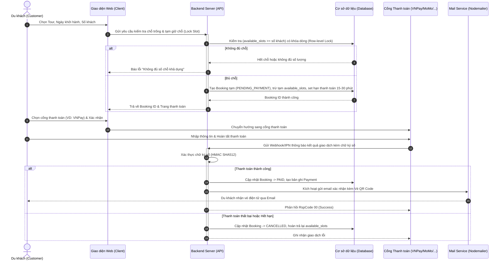
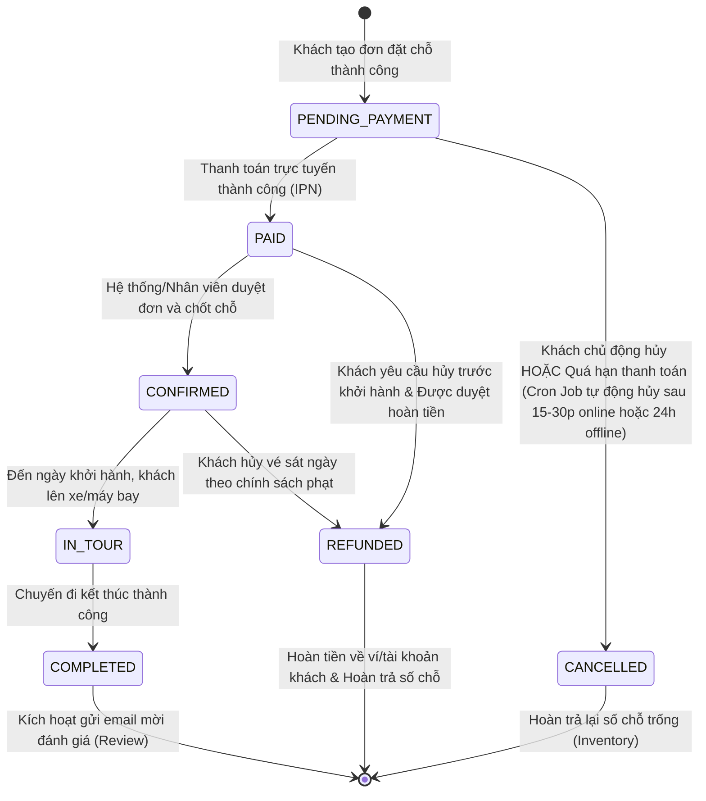

# TÀI LIỆU ĐẶC TẢ YÊU CẦU PHẦN MỀM (SRS)
## HỆ THỐNG ĐẶT TOUR DU LỊCH TRỰC TUYẾN - TRAVEL WITH ME

---

## 1. TỔNG QUAN HỆ THỐNG (SYSTEM OVERVIEW)

### 1.1. Giới thiệu dự án
- **Tên dự án:** Travel With Me - Nền tảng đặt tour du lịch trực tuyến.
- **Mục tiêu:** Xây dựng hệ thống web kết nối du khách và doanh nghiệp lữ hành, tối ưu hóa quy trình tìm kiếm, đặt chỗ, thanh toán trực tuyến đa kênh, quản lý vận hành tour và phân tích hiệu quả kinh doanh tập trung.
- **Phạm vi hệ thống:**
  - **Client (Web Du khách):** Tìm kiếm tour, xem lịch trình, đặt chỗ realtime, thanh toán tích hợp (VNPay/MoMo/ZaloPay/Stripe/VietQR), quản lý vé QR, đánh giá & tương tác.
  - **Admin / Staff Portal (Web Quản trị & Điều hành):** Quản lý tour, lịch khởi hành & chỗ trống (inventory), quản lý booking, xử lý hoàn hủy vé, phân quyền RBAC, marketing/khuyến mãi, báo cáo doanh thu & biểu đồ.
  - **System Core & Automation:** Xử lý concurrency chống overbooking, bảo mật đa tầng, tiến trình nền tự động (Cron job).

### 1.2. Danh sách tác nhân hệ thống (Actors)
| Mã tác nhân | Tên tác nhân | Mô tả vai trò |
| :--- | :--- | :--- |
| **GUEST** | Khách vãng lai | Người dùng chưa đăng nhập, chỉ có quyền xem thông tin tour, tin tức, tìm kiếm. |
| **CUSTOMER** | Du khách / Khách hàng | Người dùng đã đăng ký tài khoản, có quyền đặt tour, thanh toán, quản lý vé, đánh giá. |
| **STAFF** | Nhân viên điều hành | Nhân viên quản lý danh sách booking, kiểm tra thanh toán, xác nhận đơn, xuất danh sách cho HDV. |
| **ADMIN** | Quản trị viên cấp cao | Toàn quyền cấu hình hệ thống: CRUD tour, phân quyền tài khoản, tạo mã giảm giá, xem báo cáo doanh thu. |
| **SYSTEM** | Hệ thống tự động (Cron) | Tự động quét đơn quá hạn hủy vé, gửi email thông báo, nhắc lịch và kích hoạt đánh giá. |

---

## 2. BẢNG ĐẶC TẢ YÊU CẦU CHỨC NĂNG (FUNCTIONAL SPECIFICATIONS)

### 2.1. Phân hệ Khách hàng (Client Portal)

#### A. Xác thực & Tài khoản cá nhân
| Mã UC | Chức năng | Tác nhân | Mô tả & Luồng xử lý | Dữ liệu đầu vào (Input) | Kết quả đầu ra (Output) | Quy tắc nghiệp vụ (Business Rules) | Mức độ ưu tiên |
| :--- | :--- | :--- | :--- | :--- | :--- | :--- | :--- |
| **CLI-AUTH-01** | Đăng ký tài khoản | GUEST | Khách nhập email, mật khẩu; hệ thống gửi mã OTP/link kích hoạt qua email để xác thực. | Họ tên, email, mật khẩu (xác nhận lại) | Tài khoản được tạo ở trạng thái `INACTIVE`; email kích hoạt được gửi. | Mật khẩu tối thiểu 8 ký tự, có chữ hoa, số; email là duy nhất; link kích hoạt hết hạn sau 15 phút. | **Cao (Must)** |
| **CLI-AUTH-02** | Đăng nhập hệ thống | GUEST | Đăng nhập bằng Email/Mật khẩu hoặc Đăng nhập nhanh bằng Google OAuth. | Email, Mật khẩu hoặc Token Google | Phiên đăng nhập (JWT Access Token & Refresh Token lưu HTTP-only Cookie). | Sai mật khẩu quá 5 lần sẽ khóa tạm thời 15 phút; Google OAuth tự động liên kết nếu trùng email. | **Cao (Must)** |
| **CLI-AUTH-03** | Quên & Đổi mật khẩu | GUEST, CUSTOMER | Yêu cầu reset qua email nhận link token có thời hạn; hoặc đổi mật khẩu trực tiếp trong trang hồ sơ. | Email (nếu quên) hoặc Mật khẩu cũ + Mật khẩu mới | Email chứa link đổi mật khẩu kèm token; hoặc thông báo cập nhật thành công. | Token reset mật khẩu có hiệu lực trong 10 phút và chỉ sử dụng được 1 lần; mật khẩu mới khác mật khẩu cũ. | **Trung bình** |
| **CLI-PROF-01** | Quản lý hồ sơ cá nhân | CUSTOMER | Xem và cập nhật thông tin cá nhân: Họ tên, số điện thoại, ngày sinh, địa chỉ, ảnh đại diện (avatar). | Họ tên, SĐT, ngày sinh, địa chỉ, file ảnh đại diện | Thông tin hồ sơ được cập nhật; ảnh tải lên Cloudinary. | Định dạng ảnh JPG/PNG/WEBP < 5MB; SĐT tuân thủ chuẩn Việt Nam (10 số). | **Trung bình** |
| **CLI-PROF-02** | Xem lịch sử chuyến đi | CUSTOMER | Tra cứu danh sách các đơn đặt tour theo các tab: Sắp đi, Đã hoàn thành, Đã hủy. | Bộ lọc theo trạng thái, từ khóa tìm kiếm | Danh sách booking kèm chi tiết ngày đi, điểm đến, trạng thái thanh toán. | Phân trang 10 đơn/trang; hiển thị mã đơn, ngày đặt, tổng tiền và trạng thái. | **Cao (Must)** |
| **CLI-PROF-03** | Tải vé điện tử / Hóa đơn PDF | CUSTOMER | Xem và tải file PDF vé điện tử có chứa mã QR định danh đơn hàng và chi tiết hành khách. | Mã đơn hàng (Booking ID) | File PDF vé điện tử (chứa QR code, logo, thông tin chuyến đi, danh sách khách). | Chỉ tải được khi đơn hàng ở trạng thái `CONFIRMED` hoặc `PAID`. | **Cao (Must)** |

#### B. Khám phá, Tìm kiếm & Lọc Tour
| Mã UC | Chức năng | Tác nhân | Mô tả & Luồng xử lý | Dữ liệu đầu vào (Input) | Kết quả đầu ra (Output) | Quy tắc nghiệp vụ (Business Rules) | Mức độ ưu tiên |
| :--- | :--- | :--- | :--- | :--- | :--- | :--- | :--- |
| **CLI-TOUR-01** | Tìm kiếm tour nhanh | GUEST, CUSTOMER | Tìm kiếm bằng từ khóa trên thanh header (theo tên tour, điểm đến, địa danh). | Từ khóa (Keyword search) | Danh sách gợi ý tour phù hợp với từ khóa. | Hỗ trợ tìm kiếm không dấu / có dấu tiếng Việt, debounce 300ms. | **Cao (Must)** |
| **CLI-TOUR-02** | Bộ lọc nâng cao (Multi-filter) | GUEST, CUSTOMER | Lọc kết quả theo nhiều tiêu chí kết hợp: điểm khởi hành, điểm đến, thời gian (số ngày), khoảng giá, loại hình, phương tiện. | Điểm khởi hành, điểm đến, ngày đi, slider giá (min-max), thể loại, phương tiện | Danh sách tour được lọc tức thời theo các điều kiện. | Giữ nguyên trạng thái bộ lọc trên URL Params để hỗ trợ chia sẻ liên kết; cập nhật số lượng kết quả. | **Cao (Must)** |
| **CLI-TOUR-03** | Sắp xếp kết quả | GUEST, CUSTOMER | Sắp xếp danh sách hiển thị theo các tiêu chí: Giá tăng dần, Giá giảm dần, Đánh giá cao nhất, Mới nhất, Phổ biến nhất. | Tiêu chí sắp xếp lựa chọn | Danh sách tour được sắp xếp lại. | Mặc định sắp xếp theo Độ phổ biến (số lượt đặt cao nhất). | **Trung bình** |
| **CLI-TOUR-04** | Xem chi tiết tour | GUEST, CUSTOMER | Hiển thị toàn bộ thông tin tour: Tổng quan, thời lượng, bảng giá theo độ tuổi, lịch trình (Itinerary), dịch vụ bao gồm/loại trừ, chính sách hoàn hủy, tour tương tự. | ID/Slug của tour | Trang chi tiết tour hoàn chỉnh, responsive, tối ưu SEO. | Tải dữ liệu ảnh tối ưu từ CDN; hiển thị đánh giá trung bình và số lượng review. | **Cao (Must)** |
| **CLI-TOUR-05** | Tích hợp bản đồ lộ trình | GUEST, CUSTOMER | Xem bản đồ tương tác hiển thị các điểm dừng chân, khách sạn, danh lam thắng cảnh trong tour. | Dữ liệu tọa độ các điểm dừng của tour | Bản đồ tương tác (Google Maps / Leaflet) có đánh dấu điểm mốc (waypoints). | Tự động căn chỉnh zoom (fitBounds) vừa khít tất cả các điểm dừng của tour. | **Trung bình** |

#### C. Đặt chỗ & Thanh toán (Booking & Checkout)
| Mã UC | Chức năng | Tác nhân | Mô tả & Luồng xử lý | Dữ liệu đầu vào (Input) | Kết quả đầu ra (Output) | Quy tắc nghiệp vụ (Business Rules) | Mức độ ưu tiên |
| :--- | :--- | :--- | :--- | :--- | :--- | :--- | :--- |
| **CLI-BOOK-01** | Chọn ngày khởi hành & Số lượng khách | CUSTOMER | Chọn ngày đi trên lịch (hiển thị realtime số chỗ còn trống); chọn số Người lớn, Trẻ em, Em bé; tính tổng tiền tạm tính. | Ngày khởi hành, số lượng: Người lớn, Trẻ em, Em bé | Tổng chi phí tạm tính, kiểm tra tính khả dụng của số chỗ. | Số lượng khách đặt không được vượt quá số chỗ trống còn lại (`available_slots`). Khóa tạm chỗ trong 15 phút khi bước vào thanh toán. | **Cao (Must)** |
| **CLI-BOOK-02** | Nhập thông tin hành khách & Ghi chú | CUSTOMER | Nhập thông tin trưởng đoàn (người đặt) và danh sách chi tiết từng hành khách đi cùng; nhập yêu cầu đặc biệt. | Họ tên, SĐT, Email người đặt; Danh sách họ tên, ngày sinh, giới tính, CCCD khách đi cùng; Ghi chú | Form thông tin hợp lệ, lưu vào phiên booking tạm thời. | Kiểm tra độ tuổi theo ngày sinh để khớp với loại vé (Người lớn: >= 12t, Trẻ em: 2-11t, Em bé: < 2t). | **Cao (Must)** |
| **CLI-BOOK-03** | Áp dụng mã giảm giá (Coupon) | CUSTOMER | Nhập mã coupon khuyến mãi; hệ thống kiểm tra điều kiện (hạn dùng, đơn tối thiểu, số lượt còn lại) và trừ tiền. | Mã Coupon (chuỗi ký tự) | Số tiền giảm giá được hiển thị, tổng tiền thanh toán cuối cùng được cập nhật. | Mỗi đơn chỉ áp dụng 1 mã; nếu vi phạm điều kiện (chưa đạt giá trị đơn tối thiểu), báo lỗi rõ ràng. | **Cao (Must)** |
| **CLI-PAY-01** | Thanh toán Cổng trực tuyến (VNPay / MoMo / ZaloPay) | CUSTOMER | Chọn cổng thanh toán; hệ thống tạo URL thanh toán và chuyển hướng sang cổng đối tác; nhận kết quả qua IPN/Webhook. | Cổng thanh toán lựa chọn, Mã đơn hàng, Số tiền | Chuyển hướng sang cổng thanh toán; cập nhật trạng thái đơn thành `PAID` khi nhận IPN thành công. | Xác thực chữ ký số (Checksum/HMAC SHA512) để chống giả mạo gói tin thanh toán; xử lý idempotency. | **Cao (Must)** |
| **CLI-PAY-02** | Thanh toán Chuyển khoản VietQR | CUSTOMER | Hiển thị mã VietQR động chứa số tài khoản, tên ngân hàng, số tiền chính xác và nội dung chuyển khoản là mã đơn hàng. | Lựa chọn phương thức VietQR | Mã VietQR động trên màn hình kèm hướng dẫn chuyển khoản. | Mã đơn hàng trong nội dung chuyển khoản là duy nhất để tự động/bán tự động đối soát. | **Cao (Must)** |
| **CLI-PAY-03** | Thanh toán Thẻ quốc tế (Stripe) | CUSTOMER | Nhập thông tin thẻ Visa/Mastercard trực tiếp qua Stripe Elements an toàn. | Thông tin thẻ (Card number, CVC, Expiry) | Thông báo giao dịch thành công/thất bại, mã giao dịch Stripe. | Tuân thủ PCI-DSS qua Stripe Elements (không lưu thông tin thẻ trên máy chủ Travel With Me). | **Trung bình** |
| **CLI-PAY-04** | Thanh toán tại văn phòng / Tiền mặt | CUSTOMER | Chọn thanh toán tại quầy; hệ thống tạo đơn với trạng thái `PENDING_PAYMENT` và gửi hướng dẫn hạn thanh toán. | Lựa chọn phương thức "Tại văn phòng" | Mã đơn hàng, phiếu hẹn thanh toán kèm thời hạn giữ chỗ (ví dụ: trong vòng 24h). | Nếu quá hạn 24h mà chưa đến văn phòng nộp tiền, hệ thống tự động hủy đơn và hoàn trả chỗ trống. | **Trung bình** |
| **CLI-BOOK-04** | Gửi Email xác nhận & Vé điện tử QR | SYSTEM | Sau khi đơn chuyển sang `PAID` hoặc `CONFIRMED`, hệ thống tự động gửi email xác nhận kèm vé điện tử có mã QR. | Booking ID, Email khách hàng | Email định dạng HTML chuyên nghiệp kèm file vé điện tử và mã QR. | Gửi thông qua Nodemailer với SMTP (Gmail/SendGrid/SES); mã QR mã hóa token kiểm tra tính hợp lệ của vé. | **Cao (Must)** |

#### D. Tương tác & Trải nghiệm
| Mã UC | Chức năng | Tác nhân | Mô tả & Luồng xử lý | Dữ liệu đầu vào (Input) | Kết quả đầu ra (Output) | Quy tắc nghiệp vụ (Business Rules) | Mức độ ưu tiên |
| :--- | :--- | :--- | :--- | :--- | :--- | :--- | :--- |
| **CLI-FEAT-01** | Lưu danh sách yêu thích (Wishlist) | CUSTOMER | Bấm nút tim để lưu tour vào danh sách yêu thích hoặc bỏ lưu. | Tour ID | Tour được thêm/bỏ khỏi wishlist của người dùng. | Yêu cầu đăng nhập; hiển thị danh sách nhanh trong trang quản lý cá nhân. | **Trung bình** |
| **CLI-FEAT-02** | Đánh giá & Phản hồi (Reviews & Rating) | CUSTOMER | Chấm điểm (1-5 sao), viết nhận xét và upload hình ảnh thực tế sau khi đi tour về. | Tour ID, số sao (1-5), nội dung text, ảnh chụp thực tế (tối đa 5 ảnh) | Đánh giá được lưu; điểm đánh giá trung bình của tour được cập nhật. | **Chỉ áp dụng cho tài khoản đã có đơn đặt tour này ở trạng thái `COMPLETED`**; mỗi đơn chỉ được đánh giá 1 lần. | **Cao (Must)** |
| **CLI-FEAT-03** | Hỗ trợ trực tuyến / Chatbot tư vấn | GUEST, CUSTOMER | Mở widget chat góc màn hình để nhận hỗ trợ trực tiếp hoặc hỏi đáp tự động với AI Bot. | Câu hỏi / tin nhắn của người dùng | Tin nhắn phản hồi từ nhân viên CSKH hoặc câu trả lời tự động từ Chatbot. | Lưu lịch sử phiên chat; hỗ trợ gợi ý các tour hot dựa trên câu hỏi của khách. | **Thấp (Nice-to-have)** |

---

### 2.2. Phân hệ Quản trị viên & Nhân viên (Admin & Staff Portal)

#### A. Quản lý Tour & Lịch trình (Tour Management)
| Mã UC | Chức năng | Tác nhân | Mô tả & Luồng xử lý | Dữ liệu đầu vào (Input) | Kết quả đầu ra (Output) | Quy tắc nghiệp vụ (Business Rules) | Mức độ ưu tiên |
| :--- | :--- | :--- | :--- | :--- | :--- | :--- | :--- |
| **ADM-TOUR-01** | Thêm mới tour du lịch | ADMIN, STAFF | Nhập thông tin tổng quan: tên tour, điểm xuất phát, điểm đến, thời lượng, chính sách giá vé, dịch vụ bao gồm/loại trừ, chính sách hoàn hủy. | Thông tin chi tiết tour, danh mục, hình thức di chuyển | Tour mới được tạo ở trạng thái `DRAFT` hoặc `ACTIVE`. | Tiêu đề tour không trùng lặp; slug URL chuẩn SEO tự động tạo từ tên tour. | **Cao (Must)** |
| **ADM-TOUR-02** | Cập nhật & Tạm ngừng tour | ADMIN, STAFF | Chỉnh sửa nội dung tour hoặc chuyển trạng thái sang `INACTIVE` (tạm ngừng nhận khách). | Tour ID, dữ liệu cần cập nhật | Dữ liệu tour được cập nhật trên website. | Không thể xóa cứng tour đã phát sinh booking; chỉ được chuyển trạng thái ngừng kinh doanh. | **Cao (Must)** |
| **ADM-TOUR-03** | Quản lý Media (Ảnh & Video) | ADMIN, STAFF | Tải lên ảnh đại diện (thumbnail), album ảnh chi tiết, liên kết video giới thiệu. | File ảnh/video tải lên | Ảnh được lưu trên Cloudinary và trả về URL CDN tối ưu. | Tự động resize/nén ảnh dạng WebP; hỗ trợ kéo thả sắp xếp thứ tự ảnh. | **Cao (Must)** |
| **ADM-TOUR-04** | Quản lý lịch trình từng ngày (Itinerary) | ADMIN, STAFF | Thiết lập lộ trình chi tiết: Ngày 1, Ngày 2,... kèm tiêu đề chặng, hoạt động, địa điểm ăn uống, nghỉ ngơi và hình ảnh minh họa. | Số ngày, tiêu đề từng ngày, nội dung chi tiết, hình ảnh chặng, tọa độ GPS | Lịch trình hoàn chỉnh được liên kết với tour. | Số ngày lịch trình phải khớp với tổng thời lượng tour (ví dụ: 3N2Đ phải có 3 ngày chi tiết). | **Cao (Must)** |
| **ADM-TOUR-05** | Quản lý ngày khởi hành & Suất đặt (Slots/Inventory) | ADMIN, STAFF | Thiết lập danh sách các ngày khởi hành cụ thể cho từng tour, cấu hình số chỗ tối đa (`max_capacity`), số chỗ tối thiểu (`min_capacity`), giá vé theo từng đợt. | Ngày khởi hành, giá vé (người lớn, trẻ em, em bé), số lượng chỗ | Lịch khởi hành mới được kích hoạt cho khách đặt. | Hệ thống tự động tính số chỗ còn lại: `available_slots = max_capacity - booked_slots`. Khi `available_slots == 0`, tự động khóa đặt chỗ. | **Cao (Must)** |
| **ADM-TOUR-06** | Quản lý Điểm đến & Danh mục | ADMIN | Phân loại tour theo vùng miền (Bắc/Trung/Nam), quốc gia, loại hình (Nghỉ dưỡng, Trekking, Văn hóa,...). | Tên danh mục, mô tả, ảnh đại diện, vị trí hiển thị | Danh mục tour được cập nhật trên menu và bộ lọc. | Không được xóa danh mục khi còn tour trực thuộc. | **Trung bình** |

#### B. Quản lý Đơn đặt tour (Booking Management)
| Mã UC | Chức năng | Tác nhân | Mô tả & Luồng xử lý | Dữ liệu đầu vào (Input) | Kết quả đầu ra (Output) | Quy tắc nghiệp vụ (Business Rules) | Mức độ ưu tiên |
| :--- | :--- | :--- | :--- | :--- | :--- | :--- | :--- |
| **ADM-BOOK-01** | Danh sách Booking tập trung | ADMIN, STAFF | Xem danh sách tất cả các đơn đặt tour; lọc theo mã đơn, ngày đặt, ngày khởi hành, trạng thái thanh toán, tour. | Bộ lọc tìm kiếm booking | Bảng dữ liệu booking có phân trang, tô màu trạng thái. | Hiển thị tóm tắt: Mã đơn, tên khách, SĐT, số người, tổng tiền, trạng thái đơn, trạng thái thanh toán. | **Cao (Must)** |
| **ADM-BOOK-02** | Xem chi tiết & Chuyển trạng thái đơn | ADMIN, STAFF | Xem chi tiết từng hành khách, lịch sử thanh toán, ghi chú yêu cầu; cập nhật trạng thái đơn theo quy trình. | Booking ID, trạng thái mới | Trạng thái đơn được cập nhật; hệ thống gửi email thông báo cho khách nếu có thay đổi quan trọng. | Tuân thủ luồng: `PENDING_PAYMENT` -> `PAID` -> `CONFIRMED` -> `IN_TOUR` -> `COMPLETED` / `CANCELLED`. | **Cao (Must)** |
| **ADM-BOOK-03** | Xử lý Yêu cầu Hủy & Hoàn tiền (Refund) | ADMIN, STAFF | Tiếp nhận yêu cầu hủy vé của khách; hệ thống tự động tính % số tiền hoàn lại theo chính sách dựa trên số ngày trước khởi hành; xác nhận hoàn tiền. | Booking ID, lý do hủy, số tiền hoàn tính toán | Trạng thái chuyển thành `REFUNDED` hoặc `CANCELLED`; hoàn trả lại số chỗ trống cho tour. | Phải cộng trả lại `available_slots` của ngày khởi hành tương ứng; lưu vết giao dịch hoàn tiền. | **Cao (Must)** |
| **ADM-BOOK-04** | Xuất danh sách hành khách đi tour (Export) | ADMIN, STAFF | Xuất danh sách toàn bộ hành khách của một chuyến đi cụ thể ra file Excel/CSV phục vụ cho HDV và nhà xe. | Tour ID, Ngày khởi hành cụ thể | File Excel (.xlsx) / CSV chứa danh sách khách (Họ tên, năm sinh, giới tính, CCCD, SĐT, ghi chú ăn uống). | Chỉ xuất những khách thuộc các đơn hàng đã `CONFIRMED` hoặc `PAID`. | **Cao (Must)** |

#### C. Quản lý Người dùng & Phân quyền (RBAC)
| Mã UC | Chức năng | Tác nhân | Mô tả & Luồng xử lý | Dữ liệu đầu vào (Input) | Kết quả đầu ra (Output) | Quy tắc nghiệp vụ (Business Rules) | Mức độ ưu tiên |
| :--- | :--- | :--- | :--- | :--- | :--- | :--- | :--- |
| **ADM-USER-01** | Phân quyền tài khoản (RBAC) | ADMIN | Phân quyền nhóm người dùng: Super Admin (toàn quyền), Staff (chỉ tour, booking, khách), Customer (chỉ tài khoản cá nhân). | User ID, Role cần gán | Quyền hạn tài khoản được cập nhật tức thì. | Staff không được xóa tour, không được sửa quyền của người khác, không được xem báo cáo tài chính cấp cao. | **Cao (Must)** |
| **ADM-USER-02** | Quản lý danh sách khách hàng | ADMIN, STAFF | Tra cứu thông tin khách hàng, số lần đặt tour, tổng chi tiêu; khóa/mở khóa tài khoản khi có dấu hiệu gian lận. | Từ khóa tìm kiếm (Tên, SĐT, Email), Trạng thái tài khoản | Danh sách khách hàng và lịch sử tương tác. | Khóa tài khoản sẽ thu hồi ngay các phiên đăng nhập (refresh token) đang hoạt động. | **Trung bình** |

#### D. Marketing & Khuyến mãi & Nội dung
| Mã UC | Chức năng | Tác nhân | Mô tả & Luồng xử lý | Dữ liệu đầu vào (Input) | Kết quả đầu ra (Output) | Quy tắc nghiệp vụ (Business Rules) | Mức độ ưu tiên |
| :--- | :--- | :--- | :--- | :--- | :--- | :--- | :--- |
| **ADM-MKT-01** | Quản lý Mã giảm giá (Coupons) | ADMIN | Tạo mới, kích hoạt, vô hiệu hóa mã giảm giá: giảm theo % hoặc số tiền cố định, cấu hình điều kiện áp dụng. | Mã code, loại giảm (%, cố định), giá trị giảm, giá trị đơn tối thiểu, số lượt tối đa, ngày bắt đầu, ngày kết thúc | Mã coupon có hiệu lực trên hệ thống đặt tour. | Mã code viết hoa, không khoảng trắng; kiểm tra ngày hết hạn >= ngày bắt đầu; không cho phép giảm vượt quá tổng đơn. | **Cao (Must)** |
| **ADM-BLOG-01** | Quản lý Tin tức / Cẩm nang du lịch (Blog) | ADMIN, STAFF | Soạn thảo, xuất bản bài viết cẩm nang du lịch, kinh nghiệm tham quan, chuẩn hóa SEO (meta title, description, slug). | Tiêu đề, nội dung HTML (Rich Text), ảnh đại diện, tags, meta SEO | Bài viết được đăng tải trên mục Cẩm nang du lịch của website. | Hỗ trợ trình soạn thảo phong phú (WYSIWYG); tự động tạo mục lục từ các thẻ H2, H3. | **Trung bình** |

#### E. Báo cáo & Thống kê (Analytics Dashboard)
| Mã UC | Chức năng | Tác nhân | Mô tả & Luồng xử lý | Dữ liệu đầu vào (Input) | Kết quả đầu ra (Output) | Quy tắc nghiệp vụ (Business Rules) | Mức độ ưu tiên |
| :--- | :--- | :--- | :--- | :--- | :--- | :--- | :--- |
| **ADM-STAT-01** | Báo cáo doanh thu & biểu đồ | ADMIN | Xem tổng quan doanh thu theo khoảng thời gian (hôm nay, tuần này, tháng này, quý, năm); biểu đồ trực quan hóa dữ liệu. | Khoảng thời gian lọc (Date range) | Biểu đồ cột/đường doanh thu (Chart.js), thẻ tổng doanh thu, lợi nhuận ròng dự kiến. | Doanh thu chỉ tính trên các đơn hàng đã thanh toán thành công (`PAID`, `CONFIRMED`, `COMPLETED`), trừ đi các đơn hoàn tiền (`REFUNDED`). | **Cao (Must)** |
| **ADM-STAT-02** | Thống kê hiệu suất tour | ADMIN | Xếp hạng Top tour bán chạy nhất, tour có tỷ lệ lấp đầy (occupancy rate) cao nhất, tour bị hủy nhiều nhất. | Tiêu chí thống kê, khoảng thời gian | Bảng và biểu đồ tròn tỷ trọng các tour đóng góp doanh thu. | Cảnh báo các tour cận ngày khởi hành nhưng tỷ lệ đặt dưới 50% số chỗ tối thiểu (`min_capacity`). | **Cao (Must)** |
| **ADM-STAT-03** | Thống kê khách hàng & Tỷ lệ chuyển đổi | ADMIN | Thống kê số lượng đăng ký mới, số khách đặt tour lần đầu, số khách hàng trung thành quay lại. | Khoảng thời gian | Chỉ số tỷ lệ khách quay lại (Retention rate), giá trị trung bình mỗi đơn (AOV). | Giúp doanh nghiệp đo lường hiệu quả các chiến dịch khuyến mãi. | **Trung bình** |

---

## 3. QUY TRÌNH NGHIỆP VỤ & SƠ ĐỒ TRẠNG THÁI (BUSINESS LOGIC)

### 3.1. Sơ đồ luồng Đặt tour & Giữ chỗ (Booking & Concurrency Flow)


### 3.2. Sơ đồ trạng thái Đơn đặt tour (Booking State Machine)


### 3.3. Bảng quy tắc hoàn tiền theo chính sách hủy tour (Refund Rules Matrix)
| Thời điểm khách gửi yêu cầu hủy | Tỷ lệ hoàn tiền khách nhận | Tỷ lệ phí phạt hủy vé | Hành động hệ thống |
| :--- | :--- | :--- | :--- |
| **Trước ngày khởi hành >= 15 ngày** | **100%** tổng tiền đã thanh toán | 0% | Hoàn tiền 100%, tự động cộng lại chỗ trống cho tour. |
| **Trước ngày khởi hành 7 - 14 ngày** | **70%** tổng tiền đã thanh toán | 30% | Giữ lại 30% phí phạt, hoàn 70% cho khách, mở lại chỗ. |
| **Trước ngày khởi hành 3 - 6 ngày** | **50%** tổng tiền đã thanh toán | 50% | Giữ lại 50% phí phạt, hoàn 50% cho khách, mở lại chỗ. |
| **Trước ngày khởi hành < 3 ngày** | **0%** (Không được hoàn tiền) | 100% | Giữ nguyên trạng thái vé hủy không hoàn tiền, không hoàn tiền. |

---

## 4. BẢNG ĐẶC TẢ YÊU CẦU PHI CHỨC NĂNG (NON-FUNCTIONAL SPECIFICATIONS)

### 4.1. Hiệu năng & Xử lý đồng thời (Performance & Concurrency)
- **Kiểm soát Overbooking (Race Condition):**
  - Khi nhiều khách cùng đặt vé vào 1 giây cuối cùng cho những chỗ cuối cùng, hệ thống áp dụng cơ chế khóa bi quan (Pessimistic Locking / `SELECT ... FOR UPDATE`) hoặc Database Transaction Isolation Level cao trong Node.js/PostgreSQL/MySQL (hoặc Atomic Operations trong MongoDB `$inc` với điều kiện `$gte`).
  - Đảm bảo **tuyệt đối không bao giờ xảy ra tình trạng số chỗ đã đặt vượt quá số chỗ cho phép (`max_capacity`)**.
- **Tốc độ phản hồi (Response Time):**
  - Thời gian tải trang tìm kiếm tour: < 1.5 giây.
  - Tốc độ phản hồi API trung bình: < 300ms.
  - Sử dụng Redis Cache cho các API danh mục tour, danh sách tour hot, cấu hình hệ thống.
- **Khả năng chịu tải:** Đáp ứng tối thiểu 1.000 người dùng truy cập đồng thời và 100 giao dịch đặt tour/phút trong các dịp cao điểm.

### 4.2. An toàn & Bảo mật (Security Specifications)
- **Mã hóa thông tin:** Mật khẩu người dùng được băm an toàn 1 chiều bằng thuật toán `bcrypt` (Salt round >= 10).
- **Xác thực & Ủy quyền:** Sử dụng JWT (JSON Web Token) gồm Access Token (hạn ngắn 15 phút) và Refresh Token (lưu trong HTTP-Only Secure Cookie, thời hạn 7 ngày).
- **Phòng chống tấn công:**
  - Áp dụng `helmet` cho Node.js server để chống Clickjacking, X-XSS-Protection, Sniffing.
  - Áp dụng Rate Limiting (`express-rate-limit`): Giới hạn tối đa 100 request/phút trên mỗi IP, tối đa 5 lần thử đăng nhập/phút để chống brute-force.
  - Chuẩn hóa đầu vào (Input Sanitization) và Parameterized Query / ORM để ngăn chặn hoàn toàn SQL Injection / NoSQL Injection và XSS.
  - Tích hợp CORS nghiêm ngặt: Chỉ cho phép tên miền frontend được chỉ định truy cập API.

### 4.3. Tự động hóa tác vụ hệ thống (Cron Jobs & Scheduled Tasks)
| Mã Cron | Tác vụ | Tần suất chạy | Mô tả chi tiết hành động |
| :--- | :--- | :--- | :--- |
| **CRON-01** | Quét hủy đơn quá hạn thanh toán | Mỗi 5 phút (`*/5 * * * *`) | Tìm các đơn có trạng thái `PENDING_PAYMENT` có thời gian tạo quá hạn (quá 20 phút với thanh toán online, quá 24h với thanh toán tại quầy) -> Chuyển thành `CANCELLED` -> Cộng hoàn trả lại số chỗ (`available_slots`). |
| **CRON-02** | Gửi email nhắc lịch trước chuyến đi | Hằng ngày lúc 08:00 sáng (`0 8 * * *`) | Tìm tất cả các đơn `CONFIRMED` có ngày khởi hành là ngày mai -> Gửi email nhắc nhở khách hàng: thời gian đón, địa điểm tập trung, đồ dùng cần mang, thông tin liên hệ của HDV. |
| **CRON-03** | Gửi lời mời đánh giá sau chuyến đi | Hằng ngày lúc 18:00 chiều (`0 18 * * *`) | Tìm các đơn có ngày kết thúc tour là ngày hôm qua -> Tự động chuyển trạng thái đơn sang `COMPLETED` -> Gửi email cảm ơn kèm đường link đánh giá và tặng voucher giảm giá cho chuyến đi tiếp theo. |

### 4.4. Tính tương thích & Giao diện (Usability & Responsiveness)
- **Thiết kế Responsive:** Tương thích hoàn hảo trên mọi kích thước màn hình: Desktop (>= 1200px), Laptop/Tablet (768px - 1199px), Mobile (< 768px).
- **Khả năng tiếp cận (Accessibility):** Tuân thủ tiêu chuẩn tương phản màu sắc WCAG 2.1 AA, nút bấm có kích thước tối thiểu 44x44px trên thiết bị di động.
- **Tối ưu hóa SEO:** Hỗ trợ OpenGraph metadata, cấu trúc dữ liệu JSON-LD Schema (TouristTrip, Product), thân thiện với Google Search Bot.

---

## 5. THIẾT KẾ CƠ SỞ DỮ LIỆU SƠ BỘ (DATA MODEL SPECIFICATIONS)

### 5.1. Bảng `Users` (Người dùng)
- `id` (PK, UUID/INT, Auto-increment)
- `full_name` (VARCHAR(150), Not Null)
- `email` (VARCHAR(150), Unique, Not Null)
- `password_hash` (VARCHAR(255), Nullable nếu login Google)
- `phone_number` (VARCHAR(20), Nullable)
- `avatar_url` (VARCHAR(255), Nullable)
- `role` (ENUM: `'ADMIN'`, `'STAFF'`, `'CUSTOMER'`, Default: `'CUSTOMER'`)
- `status` (ENUM: `'ACTIVE'`, `'INACTIVE'`, `'BANNED'`, Default: `'ACTIVE'`)
- `google_id` (VARCHAR(100), Nullable)
- `created_at`, `updated_at` (TIMESTAMP)

### 5.2. Bảng `Tours` (Tour du lịch)
- `id` (PK, UUID/INT)
- `title` (VARCHAR(255), Not Null)
- `slug` (VARCHAR(255), Unique, Not Null)
- `category_id` (FK -> Categories.id)
- `departure_city` (VARCHAR(100), Not Null)
- `destination_city` (VARCHAR(100), Not Null)
- `duration_days` (INT, Not Null)
- `duration_nights` (INT, Not Null)
- `transport_type` (ENUM: `'PLANE'`, `'BUS'`, `'TRAIN'`, `'MIXED'`)
- `tour_type` (ENUM: `'RESORT'`, `'TREKKING'`, `'CULTURAL'`, `'FOOD'`, `'FAMILY'`)
- `overview_description` (TEXT)
- `inclusions` (TEXT) -- Dịch vụ bao gồm
- `exclusions` (TEXT) -- Dịch vụ không bao gồm
- `cancellation_policy` (TEXT)
- `thumbnail_url` (VARCHAR(255))
- `status` (ENUM: `'ACTIVE'`, `'INACTIVE'`, `'DRAFT'`)
- `rating_average` (DECIMAL(2,1), Default: 5.0)
- `review_count` (INT, Default: 0)

### 5.3. Bảng `TourSchedules` (Lịch khởi hành & Chỗ trống)
- `id` (PK, UUID/INT)
- `tour_id` (FK -> Tours.id, Cascade Delete)
- `departure_date` (DATE, Not Null)
- `return_date` (DATE, Not Null)
- `adult_price` (DECIMAL(12,2), Not Null)
- `child_price` (DECIMAL(12,2), Not Null)
- `infant_price` (DECIMAL(12,2), Not Null)
- `max_capacity` (INT, Not Null) -- Số chỗ tối đa
- `min_capacity` (INT, Default: 10) -- Số chỗ tối thiểu để khởi hành
- `booked_slots` (INT, Default: 0) -- Số chỗ đã đặt
- `status` (ENUM: `'AVAILABLE'`, `'SOLD_OUT'`, `'CLOSED'`)

### 5.4. Bảng `Bookings` (Đơn đặt tour)
- `id` (PK, UUID/INT)
- `booking_code` (VARCHAR(30), Unique, Not Null) -- VD: TWM-20261017-001
- `user_id` (FK -> Users.id)
- `tour_schedule_id` (FK -> TourSchedules.id)
- `num_adults` (INT, Default: 1)
- `num_children` (INT, Default: 0)
- `num_infants` (INT, Default: 0)
- `total_passengers` (INT, Not Null)
- `total_price` (DECIMAL(12,2), Not Null)
- `discount_amount` (DECIMAL(12,2), Default: 0)
- `final_amount` (DECIMAL(12,2), Not Null)
- `contact_name` (VARCHAR(150), Not Null)
- `contact_email` (VARCHAR(150), Not Null)
- `contact_phone` (VARCHAR(20), Not Null)
- `special_notes` (TEXT)
- `status` (ENUM: `'PENDING_PAYMENT'`, `'PAID'`, `'CONFIRMED'`, `'IN_TOUR'`, `'COMPLETED'`, `'CANCELLED'`, `'REFUNDED'`)
- `payment_method` (ENUM: `'VNPAY'`, `'MOMO'`, `'ZALOPAY'`, `'STRIPE'`, `'VIETQR'`, `'CASH'`)
- `payment_status` (ENUM: `'UNPAID'`, `'PAID'`, `'REFUNDED'`)
- `qr_code_token` (VARCHAR(255), Unique)
- `expires_at` (TIMESTAMP) -- Thời hạn giữ chỗ

### 5.5. Bảng `BookingPassengers` (Danh sách hành khách đi cùng)
- `id` (PK)
- `booking_id` (FK -> Bookings.id, Cascade Delete)
- `full_name` (VARCHAR(150), Not Null)
- `passenger_type` (ENUM: `'ADULT'`, `'CHILD'`, `'INFANT'`)
- `gender` (ENUM: `'MALE'`, `'FEMALE'`, `'OTHER'`)
- `birth_date` (DATE)
- `id_card_number` (VARCHAR(50)) -- CCCD hoặc Hộ chiếu

### 5.6. Bảng `Payments` (Lịch sử giao dịch)
- `id` (PK)
- `booking_id` (FK -> Bookings.id)
- `gateway` (VARCHAR(50)) -- VNPAY, MOMO, STRIPE,...
- `transaction_code` (VARCHAR(100)) -- Mã giao dịch từ cổng
- `amount` (DECIMAL(12,2))
- `response_payload` (JSONB / TEXT)
- `status` (ENUM: `'SUCCESS'`, `'FAILED'`, `'PENDING'`)
- `created_at` (TIMESTAMP)

### 5.7. Bảng `Reviews` (Đánh giá)
- `id` (PK)
- `user_id` (FK -> Users.id)
- `tour_id` (FK -> Tours.id)
- `booking_id` (FK -> Bookings.id, Unique)
- `rating` (INT, 1-5 sao)
- `comment` (TEXT)
- `photos` (JSONB) -- Mảng URL ảnh trên Cloudinary
- `created_at` (TIMESTAMP)

### 5.8. Bảng `Coupons` (Mã giảm giá)
- `id` (PK)
- `code` (VARCHAR(50), Unique)
- `discount_type` (ENUM: `'PERCENTAGE'`, `'FIXED_AMOUNT'`)
- `discount_value` (DECIMAL(12,2))
- `min_order_amount` (DECIMAL(12,2), Default: 0)
- `max_discount` (DECIMAL(12,2), Nullable)
- `usage_limit` (INT) -- Tổng số lần được dùng
- `used_count` (INT, Default: 0)
- `start_date` (TIMESTAMP)
- `end_date` (TIMESTAMP)
- `is_active` (BOOLEAN, Default: true)

---

## 6. ĐỀ XUẤT KIẾN TRÚC CÔNG NGHỆ (TECH STACK ARCHITECTURE)

```
+---------------------------------------------------------------------------------+
|                               CLIENT LAYER                                      |
|  - Web Du khách (Client) & Web Quản trị (Admin): React.js / Next.js hoặc HTML5  |
|  - Thư viện UI & Style: CSS Module / Modern Vanilla CSS / TailwindCSS           |
|  - Thư viện biểu đồ: Chart.js / Recharts                                         |
|  - Tích hợp Bản đồ: Leaflet.js / Google Maps JavaScript API                     |
+---------------------------------------------------------------------------------+
                                      | (HTTPS / RESTful API / JSON)
                                      v
+---------------------------------------------------------------------------------+
|                               SERVER LAYER (Node.js)                            |
|  - Web Framework: Express.js hoặc NestJS                                        |
|  - Authentication: Passport.js (JWT, Google OAuth2)                             |
|  - File Upload & CDN: Cloudinary SDK, Multer                                    |
|  - PDF & QR Generation: PDFKit / Puppeteer, qrcode npm                          |
|  - Email Automation: Nodemailer (SMTP Gmail / AWS SES / SendGrid)               |
|  - Cron Task Runner: node-cron                                                  |
|  - Bảo mật: Helmet, CORS, Express-Rate-Limit, Bcrypt                            |
+---------------------------------------------------------------------------------+
          |                                               |
          v                                               v
+-----------------------------+           +---------------------------------------+
|        DATABASE LAYER       |           |          THIRD-PARTY INTEGRATION      |
|  - Relational DB: PostgreSQL|           |  - Cổng thanh toán:                   |
|    hoặc MySQL               |           |    + VNPay Sandbox (HMAC SHA512)      |
|    (ORM: Prisma / Sequelize)|           |    + MoMo Payment Gateway             |
|  - Caching & Lock: Redis    |           |    + ZaloPay Gateway                  |
|    (Hỗ trợ kiểm soát        |           |    + Stripe Checkout (Visa/Master)    |
|     đặt vé đồng thời)       |           |    + VietQR API (Tạo mã QR tự động)   |
+-----------------------------+           +---------------------------------------+
```

---

## 7. KẾ HOẠCH TRIỂN KHAI THEO GIAI ĐOẠN (ROADMAP)

1. **Giai đoạn 1 - Khởi tạo nền tảng & Cơ sở dữ liệu (Sprint 1):**
   - Thiết lập cấu trúc dự án (Backend API & Frontend UI).
   - Thiết kế schema Database, migrations và seed dữ liệu mẫu.
   - Hoàn thiện module Xác thực (JWT + Google OAuth).
2. **Giai đoạn 2 - Quản trị Tour & Khám phá cho Du khách (Sprint 2):**
   - Xây dựng CRUD Tour, quản lý lịch trình, upload ảnh Cloudinary trên Admin.
   - Phát triển giao diện trang chủ, tìm kiếm nhanh, bộ lọc nâng cao và trang chi tiết tour kèm bản đồ cho Client.
3. **Giai đoạn 3 - Đặt tour, Giữ chỗ & Thanh toán (Sprint 3):**
   - Xây dựng nghiệp vụ kiểm soát số chỗ (chống overbooking).
   - Tích hợp cổng thanh toán VNPay, MoMo, VietQR và Stripe.
   - Tự động xuất vé điện tử PDF kèm QR code và gửi email qua Nodemailer.
4. **Giai đoạn 4 - Quản lý Đơn, Hủy hoàn tiền, Tương tác & Marketing (Sprint 4):**
   - Xây dựng quy trình xử lý trạng thái đơn, hủy/hoàn tiền theo chính sách.
   - Xuất danh sách hành khách ra Excel cho HDV.
   - Module đánh giá (Reviews), mã giảm giá (Coupons) và Blog du lịch.
5. **Giai đoạn 5 - Báo cáo Thống kê, Cron Jobs & Hoàn thiện (Sprint 5):**
   - Xây dựng biểu đồ doanh thu (Chart.js), thống kê tour bán chạy trên Dashboard Admin.
   - Cấu hình các Cron Job tự động hủy đơn quá hạn và nhắc lịch khởi hành.
   - Kiểm thử bảo mật, kiểm thử tải và tối ưu responsive trên mọi thiết bị.
